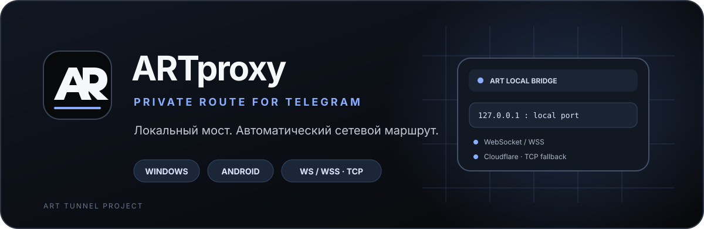
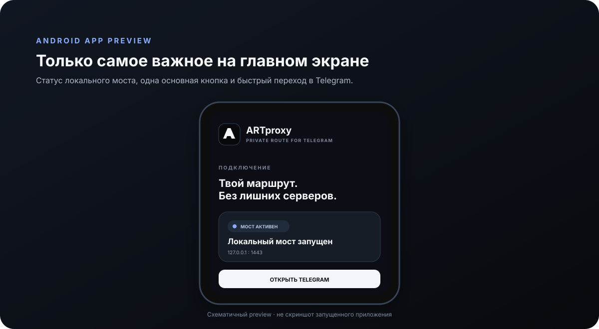

# ARTproxy

<p align="center">
  
</p>

<p align="center">
  <a href="https://github.com/graf1tyy/arttg_proxy/releases/tag/v2.0.4">Windows · v2.0.4</a>
  &nbsp; • &nbsp;
  <a href="https://github.com/graf1tyy/arttg_proxy/releases/tag/mobile-v0.3.0">Android · v0.3.0</a>
  &nbsp; • &nbsp;
  <a href="https://github.com/graf1tyy/arttg_proxy/releases">Все релизы</a>
</p>

**ARTproxy** — проект для подключения Telegram через локальный мост и автоматический сетевой маршрут. Вместо поиска случайных публичных MTProto-серверов приложение использует собственный локальный прокси-мост, который строит внешнее соединение через WS/WSS, Cloudflare и резервный TCP-маршрут.

## Возможности

| Платформа | Что внутри |
|---|---|
| **Windows** | ART Desktop, локальный мост для Telegram, автоматическая работа с сетевыми маршрутами |
| **Android** | Нативное Rust/Tokio-ядро, локальный мост, управление подключением из приложения |
| **Общее направление** | Без подбора публичных списков чужих MTProto-прокси |

## Как работает соединение

<p align="center">
  
</p>

1. ARTproxy запускает локальный мост на устройстве.
2. Telegram подключается к локальному адресу — он не является сторонним публичным сервером.
3. ARTproxy прокладывает внешний маршрут через WebSocket/WSS, Cloudflare или TCP fallback.

**Важно:** Android-версия предназначена для Telegram и совместимых клиентов, поддерживающих MTProto-прокси. Это не системный VPN: она не перенаправляет весь трафик телефона.

## Android — интерфейс

<p align="center">
  
</p>

Это концептуальная иллюстрация интерфейса, а не скриншот работающего приложения.

### Скачать Android

<https://github.com/graf1tyy/arttg_proxy/releases/tag/mobile-v0.3.0>

В релизе доступны APK и файл SHA-256 для проверки загрузки.

### Сборка Android из исходников

Требуются JDK 17, Android SDK 36, NDK 27.2.12479018, Rust stable и `cargo-ndk`.

```bash
cd ART-Kotlin/native/tgwsproxy
cargo ndk --platform 26 -t arm64-v8a -t armeabi-v7a -t x86_64 \
  -o ../../app/src/main/jniLibs build --release --locked

cd ../..
gradle --no-daemon :app:testReleaseUnitTest :app:assembleRelease
```

Готовый APK: `ART-Kotlin/app/build/outputs/apk/release/app-release.apk`.

## Windows

### Скачать Windows

<https://github.com/graf1tyy/arttg_proxy/releases/tag/v2.0.4>

Открой страницу релиза и скачай `ART.exe`. Рядом с файлом доступна контрольная сумма SHA-256.

## Структура репозитория

```text
arttg_proxy/
├── ART-Kotlin/              # Android-приложение и нативное ядро
├── ART-Desktop-v2.0.1/      # исходники Windows-версии
├── assets/                  # иллюстрации и схемы README
└── README.md
```

## Команда разработки

- **art ([@graf1tyy](https://github.com/graf1tyy))** — автор и владелец проекта, направление разработки и финальные решения.
- **ChatGPT (OpenAI)** — AI-помощник разработки: архитектура, реализация, отладка, сборка и документация.
- **Claude (Anthropic)** — AI-помощник разработки.

*ChatGPT и Claude указаны в благодарностях проекта как AI-assisted contributors, а не как отдельные GitHub-аккаунты.*

## Исходники и лицензии

- Android transport core основан на [TgwsProxyAndroid](https://github.com/wqeww0001/TgwsProxyAndroid).
- В Android-ядре используются компоненты [Flowseal/tg-ws-proxy](https://github.com/Flowseal/tg-ws-proxy).
- Лицензия и уведомления находятся в [ART-Kotlin/native/tgwsproxy/LICENSE-GPLv3](ART-Kotlin/native/tgwsproxy/LICENSE-GPLv3) и [ART-Kotlin/THIRD-PARTY-NOTICES.md](ART-Kotlin/THIRD-PARTY-NOTICES.md).

## Ссылки

- [Скачать последнюю версию](https://github.com/graf1tyy/arttg_proxy/releases)
- [Исходный код](https://github.com/graf1tyy/arttg_proxy)
- [Windows v2.0.4](https://github.com/graf1tyy/arttg_proxy/releases/tag/v2.0.4)
- [Android v0.3.0](https://github.com/graf1tyy/arttg_proxy/releases/tag/mobile-v0.3.0)
