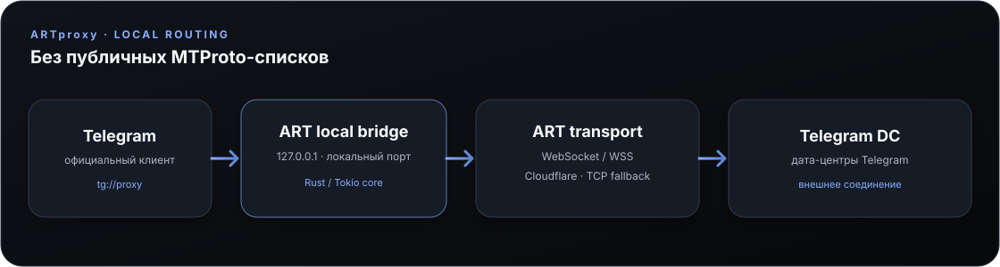

# ARTproxy

**ARTproxy** — лёгкий клиент для Telegram, который поднимает локальный MTProto-мост на устройстве и автоматически выбирает сетевой транспорт. Публичные списки чужих MTProto-прокси не используются.



## Скачать

- **Android:** [последний APK — GitHub Releases](https://github.com/graf1tyy/arttg_proxy/releases/tag/mobile-v0.3.0)
- **Windows:** [ART Desktop v2.0.4](https://github.com/graf1tyy/arttg_proxy/releases/tag/v2.0.4)

## Как это работает

1. ARTproxy запускает локальный мост на телефоне — обычно `127.0.0.1:1443`.
2. Telegram подключается к этому локальному адресу.
3. Нативный движок ART маршрутизирует соединение через WebSocket/WSS, Cloudflare и резервный TCP-маршрут.

**Важно:** Android-версия обслуживает приложения Telegram, которые умеют использовать MTProto-прокси. Это не системный VPN и не перенаправляет весь трафик телефона.

## Сборка Android

Нужны JDK 17, Android SDK 36, NDK 27.2.12479018, Rust stable и `cargo-ndk`.

```bash
cd ART-Kotlin/native/tgwsproxy
cargo ndk --platform 26 -t arm64-v8a -t armeabi-v7a -t x86_64 \
  -o ../../app/src/main/jniLibs build --release --locked

cd ../..
gradle --no-daemon :app:testReleaseUnitTest :app:assembleRelease
```

APK: `app/build/outputs/apk/release/app-release.apk`.

## Исходники и лицензии

- Android transport core основан на [TgwsProxyAndroid](https://github.com/wqeww0001/TgwsProxyAndroid), лицензия GPL-3.0.
- В ядре используются компоненты [Flowseal/tg-ws-proxy](https://github.com/Flowseal/tg-ws-proxy); сведения о лицензии сохранены в `ART-Kotlin/native/tgwsproxy/LICENSE-GPLv3` и `ART-Kotlin/THIRD-PARTY-NOTICES.md`.
- Собственный код и интерфейс ARTproxy находятся в этом репозитории.

См. [релизы](https://github.com/graf1tyy/arttg_proxy/releases) и [исходный код](https://github.com/graf1tyy/arttg_proxy).
